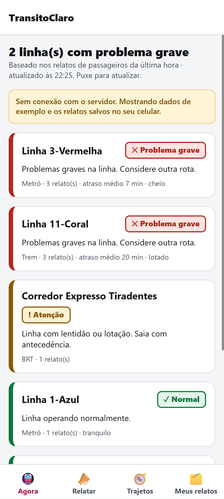
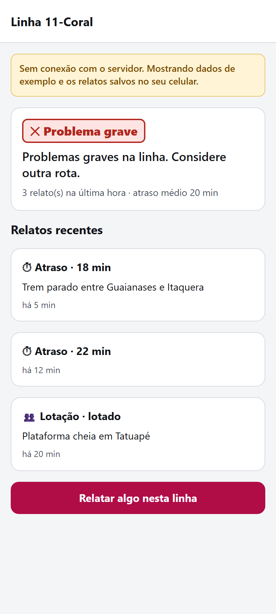
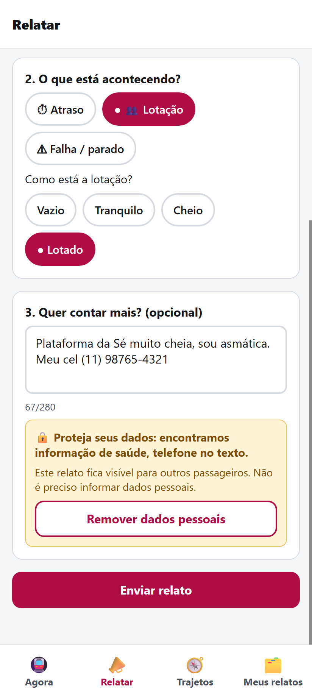
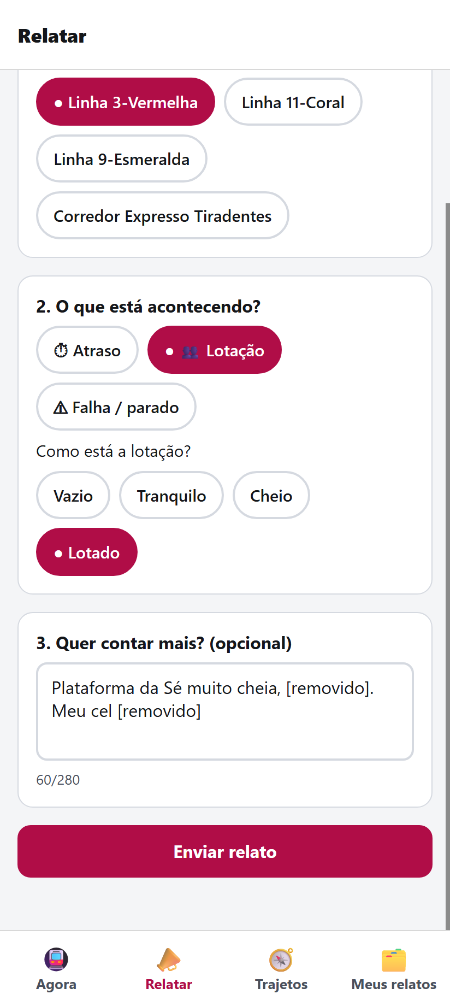
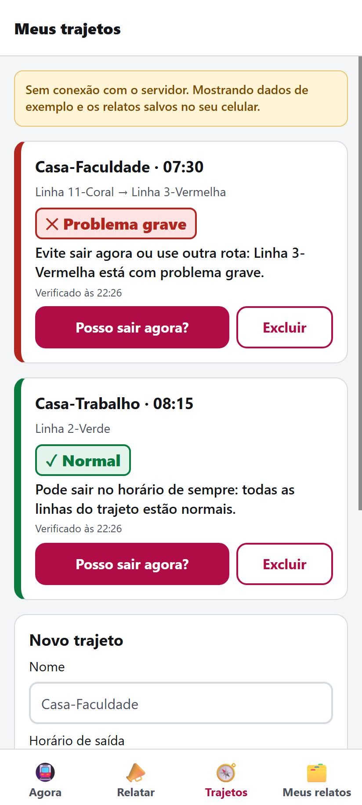
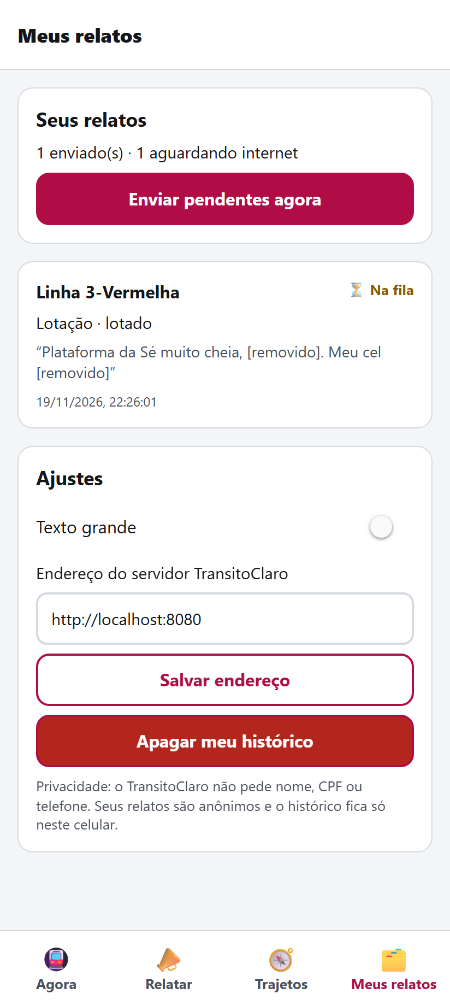

# TransitoClaro — App mobile (Expo)

> Global Solution 2026.2 · FIAP · Engenharia de Software · **Mobile Development & IOT**
> Stack: React Native + TypeScript · Expo SDK 58 · Expo Router · expo-sqlite · consumo da API REST TransitoClaro (repo SOA)

🎥 **Vídeo (até 3 min) com o app rodando:** _COLE AQUI O LINK DO YOUTUBE_

## Integrantes

| Nome | RM |
|---|---|
| Pietro Vitor Pezzente | RM557283 |
| Eric Darakjian | RM557082 |
| Kauã Soares Guimarães | RM559044 |
| Enzo Mikael Sanches | RM558887 |

## Ficha da CitizenTech

| Campo | Resposta |
|-------|----------|
| **Nome da CitizenTech** | TransitoClaro |
| **Cidade e bairro** | São Paulo (SP): linhas que cruzam a Zona Leste e o Centro (Linha 11-Coral, Linha 3-Vermelha, Expresso Tiradentes) |
| **Cidadão beneficiado** | Passageiro que depende de metrô, trem ou BRT e precisa decidir a rota sem saber o que acontece nas linhas |
| **Problema, em uma frase** | Quem depende do transporte público perde horas porque não sabe, antes de sair, quais linhas estão atrasadas ou lotadas. |
| **Como funciona** | Os próprios passageiros enviam **relatos anônimos** (atraso, lotação, falha). A API reúne os relatos da última hora e devolve um status por linha (**Normal / Atenção / Problema grave**). O passageiro salva seus trajetos e, antes de sair, toca em **"Posso sair agora?"** e recebe um conselho: *pode sair / saia antes / evite*. |
| **O que cada parte faz** | **Mobile (este repo):** porta de entrada do cidadão: consulta o status, envia relatos, salva trajetos e alertas no SQLite e funciona offline · **SOA:** API REST de linhas, relatos, status e trajetos · **Cybersecurity:** motor PII + taint analysis que impede que dados pessoais escritos nos relatos vazem (o app usa as mesmas regras para avisar o usuário antes de enviar) · demais disciplinas: ML, IoT, infraestrutura e testes da mesma solução |
| **Link do repositório** | _link deste repositório no GitHub_ |
| **Indicador de impacto** | Nº de relatos enviados por linha/hora e nº de verificações "Posso sair agora?" que resultaram em *saia antes/evite* (minutos de espera evitados) |
| **ODS conectados** | **ODS 11** (meta 11.2, transporte público acessível e seguro), **ODS 9** (infraestrutura melhor aproveitada com dados colaborativos), **ODS 10** (informação para quem não tem alternativa ao transporte público) |

## Jornada principal do cidadão

1. Abre o app → aba **Agora** mostra as linhas com problema primeiro (ícone + palavra + cor, nunca só cor).
2. Está na plataforma lotada → aba **Relatar**: escolhe a linha, o tipo e o nível, **3 toques**, e envia.
   Se escrever CPF, telefone, e-mail, endereço, senha ou informação de saúde, o app **avisa e oferece remover** antes de enviar.
3. Antes de sair de casa → aba **Trajetos** → **"Posso sair agora?"**, e o alerta fica salvo no histórico do trajeto.
4. Sem internet? O relato fica numa **fila no SQLite** e é enviado depois (aba **Meus relatos**).

## Telas

| Agora (status das linhas) | Detalhe da linha | Relatar + aviso de privacidade |
|---|---|---|
|  |  |  |

| Dados pessoais removidos | Trajetos + "Posso sair agora?" | Meus relatos (SQLite) + ajustes |
|---|---|---|
|  |  |  |

_Prints da pré-visualização web (Expo Web, 412×915) sem o backend ligado: por isso aparece o aviso "dados de exemplo". Com a API SOA rodando, os mesmos fluxos usam dados ao vivo._

## Como rodar

Pré-requisitos: Node 20+ e o app **Expo Go** no celular (ou emulador Android/iOS).

```bash
npm install
npx expo start          # leia o QR code com o Expo Go
# ou: npx expo start --android  |  npx expo start --web
```

### Conectando na API (backend SOA)

1. Rode o backend: `mvn spring-boot:run` no repositório SOA (porta 8080).
2. No app, aba **Meus relatos → Ajustes → Endereço do servidor**:
   - emulador Android: `http://10.0.2.2:8080` (padrão)
   - iOS simulador / web: `http://localhost:8080`
   - celular físico: `http://<IP-do-seu-PC>:8080` (mesma rede Wi-Fi)

Se a API não responder em 4 s, o app usa **dados de exemplo** (as mesmas 6 linhas da migração V3 do backend, com a mesma regra de classificação) e mostra um aviso amarelo. O app nunca fica em branco.

## Como os critérios foram atendidos

| Critério | Onde |
|---|---|
| **Telas e navegação** | Expo Router: `src/app/_layout.tsx` (Stack) + `src/app/(tabs)/_layout.tsx` (4 abas) + rota dinâmica `src/app/linha/[id].tsx` com parâmetros |
| **Consumo de dados (API/mock)** | `src/services/api.ts`: `GET /status`, `GET /linhas`, `GET /relatos?linha_id=`, `POST /relatos` com tempo limite e erros tratados (`ErroApi`, problem+json do backend); fallback em `src/services/mock.ts` |
| **Banco de dados** | `src/db/database.ts`: **SQLite (expo-sqlite)** com 4 tabelas: `meus_relatos` (histórico + fila offline com sincronização), `trajetos`, `alertas` e `config` (URL da API, texto grande). `database.web.ts` replica a interface no navegador |
| **Acessibilidade** | áreas de toque ≥ 48 px, contraste AA, status com ícone + texto (não só cor), `accessibilityRole/Label/Hint/State` em todos os controles, `accessibilityLiveRegion` nos avisos, opção **Texto grande** (+30%, salva no banco) e respeito ao tamanho de fonte do sistema, linguagem simples |
| **Aderência ao problema** | jornada "posso sair agora?" em 1 toque, relato em 3 toques, funciona sem internet, relato anônimo com proteção de dados pessoais (integração com a disciplina de Cybersecurity) |
| **Documentação** | este README (Ficha, instruções, prints), `prompts.md` (uso de IA) |

## Estrutura

```
src/
  app/                 rotas (Expo Router)
    _layout.tsx        Stack raiz + provider de preferências
    (tabs)/            Agora · Relatar · Trajetos · Meus relatos
    linha/[id].tsx     detalhe da linha + relatos recentes
  components/ui.tsx    componentes acessíveis (Texto, Botao, Chip, SeloStatus, AvisoOrigem)
  services/            api.ts (REST), mock.ts (dados de exemplo), privacidade.ts (detector de dados pessoais)
  db/                  database.ts (SQLite), database.web.ts, tipos.ts
  context/             preferencias.tsx (texto grande)
  constants/theme.ts   cores de alto contraste e visual dos status
```

## Dados e privacidade

O app **não pede nome, CPF nem telefone**. Relatos são anônimos, o histórico fica só no celular e pode ser apagado em *Ajustes*. Os dados de exemplo são **simulados**; as linhas correspondem às do backend (Metrô SP, CPTM, ViaMobilidade, SPTrans). Confira com as fontes oficiais antes de qualquer uso real.

## Uso de IA

Ver [`prompts.md`](prompts.md).
